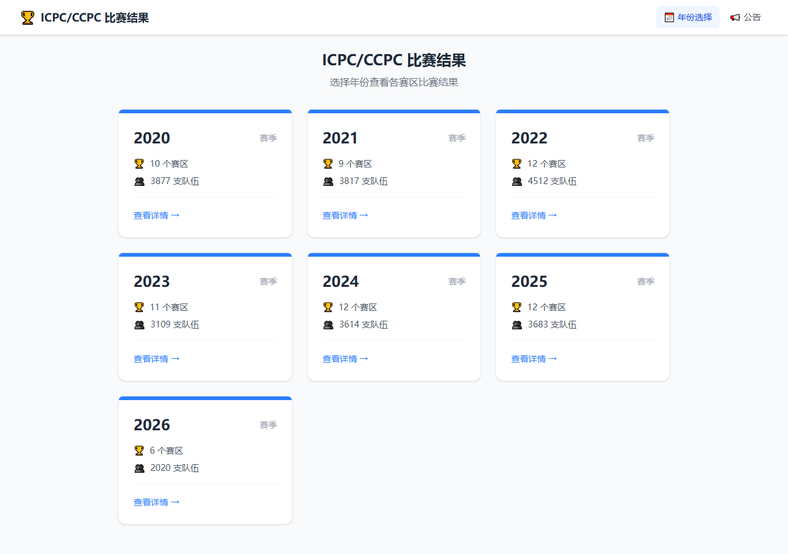
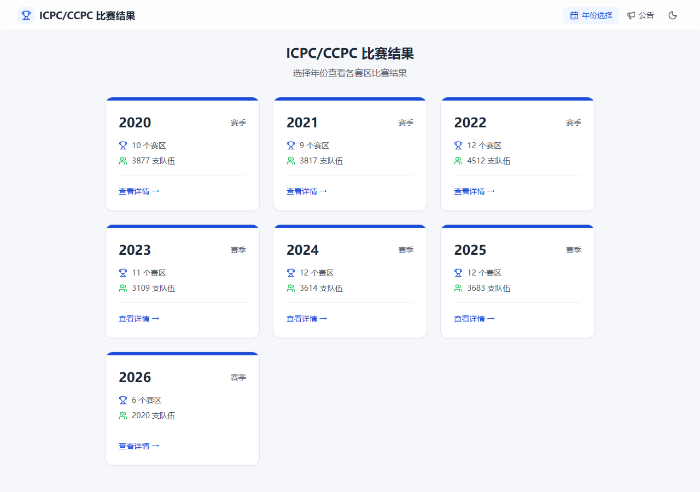
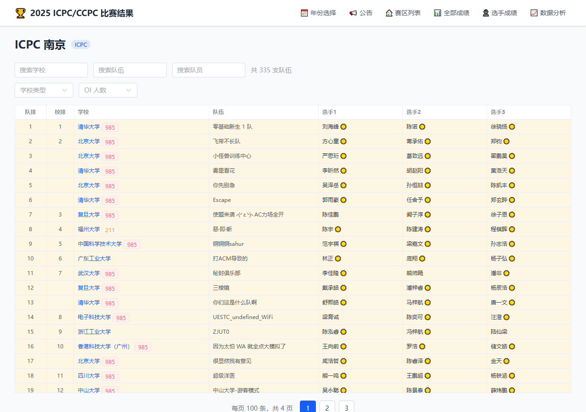
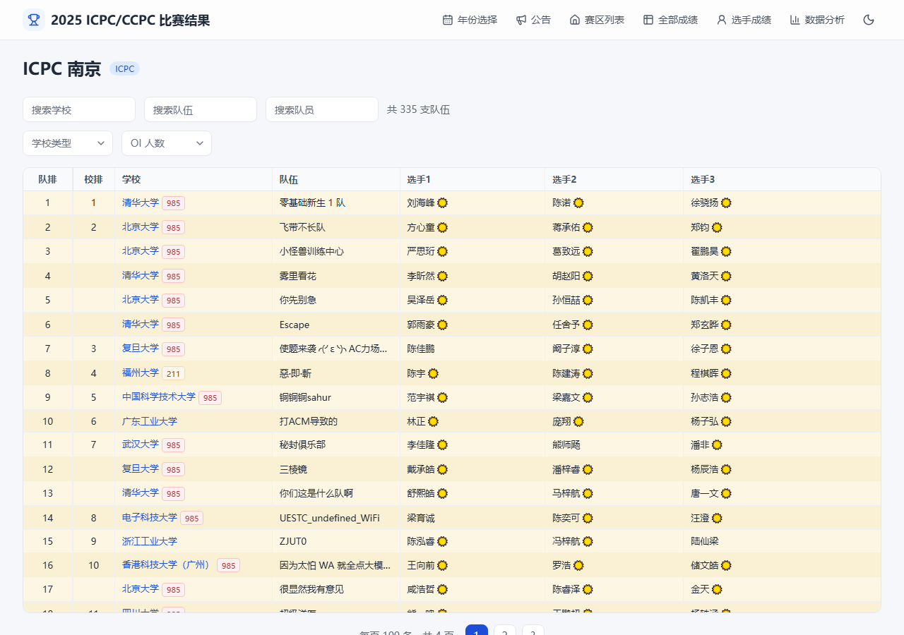
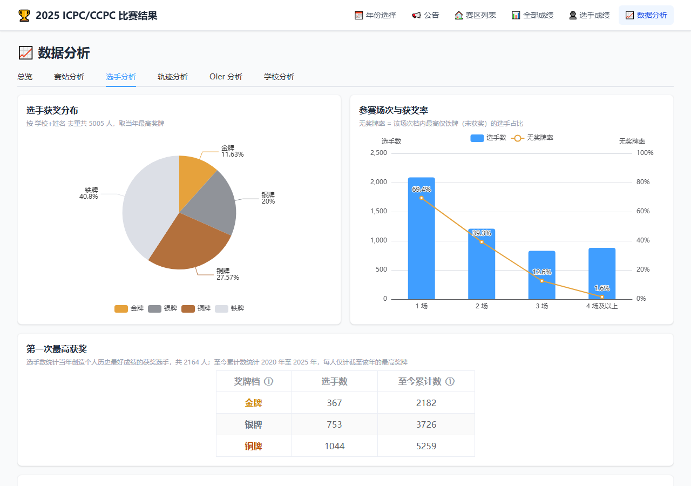
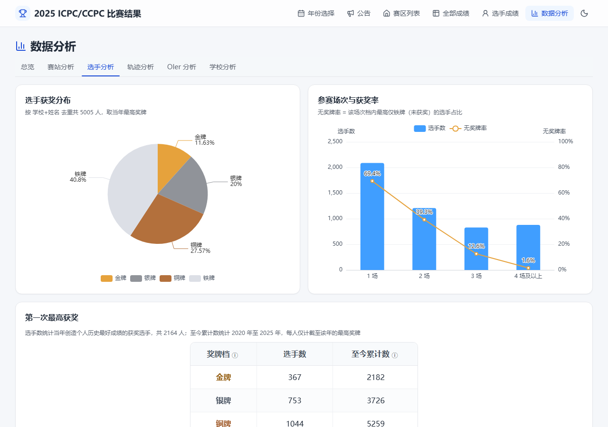
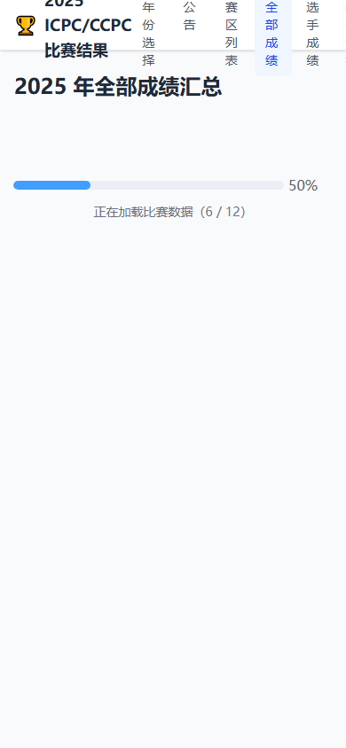
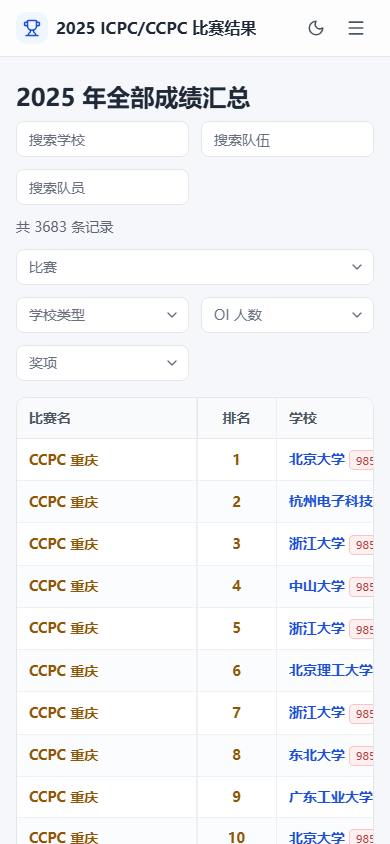

# XCPCAtlas 前端重构报告

**日期：** 2026-11-10
**分支：** `refactor/m2-shell`（未合并到 `main`，未推送）
**计划文档：** `docs/frontend-refactor-plan.md`（行为规格 `B-*`、已批准变更 D1–D7、进度日志 §13）

---

## 1. 结论

计划 M0–M7 已全部完成。前端从 Element Plus + JavaScript 迁移到 TypeScript + Reka UI + Vue Query + Web Worker，全部页面重写。

- **业务行为未改变**：7 个年份的全部统计结果与图表配置和旧代码逐字节一致（golden 测试），站内数字不变。
- **7 项已批准的改动（D1–D7）全部实现**，每项都有浏览器测试覆盖并通过。
- **全部检查通过**：类型检查、lint、单元与 golden 测试、数据校验、215 个浏览器测试、无障碍扫描。
- **首屏 JavaScript 从 321 KB 降到 46 KB**（gzip）。

上线方式：把 `refactor/m2-shell` 合并到 `main` 并推送即可触发 GitHub Pages 部署。这一步需要仓库所有者决定。

---

## 2. 提交记录

| 提交 | 里程碑 | 内容 |
|---|---|---|
| `0221936` | M0 安全网 | 冻结旧逻辑作为基线；golden 测试；按行为编号的 E2E 套件（旧版 150 个通过）；CI 测试任务 |
| `add9171` | M1 地基 | TypeScript strict、ESLint 分层约束；`domain/` 业务逻辑移植；数据层（Vue Query、Valibot、Worker）；构建时压缩 JSON；设计令牌 |
| `6ae0027` | M2–M7 | 新外壳与全部页面；动效系统；无障碍与响应式；移除 Element Plus；文档与 CI 更新 |

代码规模：`web/src` 共 93 个文件、约 5,600 行；相对重构前 118 个文件变更（+5,252 / −3,273 行）。测试代码约 2,900 行。

---

## 3. 已批准变更（D1–D7）

| 编号 | 变更 | 结果 |
|---|---|---|
| D1 | 全部成绩页去掉每个文件后的 120 ms 等待 | 仍按顺序逐个加载并显示「x / n」进度，不再人为等待 |
| D2 | 新增 404 页面 | 未知路径显示「页面不存在」；未知赛区显示「赛区不存在」并可返回赛区列表；非法年份仍跳回首页 |
| D3 | 学校页最佳排名 | 无有效排名时显示 `—`，不再显示 `#Infinity` |
| D4 | 全部成绩 / 选手成绩搜索防抖 | 输入即时显示，300 ms 后才筛选；等待期间表格淡出提示 |
| D5 | 标题、轨迹行、散点改为真实链接 | 可 Ctrl/Cmd+点击或中键在新标签打开；普通点击行为不变 |
| D6 | 构建时压缩 JSON | 123.3 MB → 62.4 MB（−49.3%），96 个文件内容逐一校验一致 |
| D7 | 选手名、学校名只解码一次 | 名称含 `%` 时可正常打开；现有数据中没有名称含 `%`，已有链接不受影响 |

---

## 4. 技术栈

| 方面 | 重构前 | 重构后 |
|---|---|---|
| 语言 | JavaScript | TypeScript 5.9（strict + `noUncheckedIndexedAccess`） |
| 构建 | Vite 8 | Vite 8.3.5（不变） |
| UI 组件 | Element Plus | Reka UI（shadcn-vue 风格封装）+ Tailwind CSS 4 |
| 数据获取 | 自写缓存 `dataLoader.js` | TanStack Vue Query + Valibot 校验 |
| 大表格 | `el-table` + 手写分页 | TanStack Table 思路的 `DataTable`（三态稳定排序、固定首列、超 200 行虚拟滚动） |
| 整年数据处理 | 主线程 | Web Worker（Comlink），不支持时自动回退主线程 |
| 状态 | 页面局部 `ref` | 页面局部 + URL；Pinia 只存主题与「减少动效」 |
| 图表 | ECharts 6 | ECharts 6（不变），新增亮/暗主题与无障碍描述 |
| 动效 | 无 | View Transitions API + motion-v + CSS 滚动驱动动画 |
| 测试 | 无 | Vitest（单元 + golden）、Playwright（E2E、axe 无障碍） |

保留 Vue 而没有改用 React/Next.js 或 Nuxt：站点是 GitHub Pages 上的纯静态页面，选手/学校名称数量不定，无法预渲染；服务端渲染对该站没有收益。保留 hash 路由，已分享的 `/#/...` 链接全部有效。

所有依赖精确锁定版本，且均为发布两周以上的版本。

---

## 5. 新目录结构（`web/src`）

ESLint 强制分层，只能向左依赖：

```
domain ← data ← shared ← entities ← features ← pages ← layouts ← app
```

| 目录 | 内容 |
|---|---|
| `domain/` | 纯 TS 业务逻辑：统计口径、筛选、分页、聚合、格式化。不依赖 Vue，golden 测试锁定 |
| `data/` | 静态 JSON 获取与校验、Vue Query 组合式函数、整年加载核心 |
| `workers/` | 整年数据 Worker |
| `shared/` | 通用组件（DataTable、Pager、FilterBar、AsyncState…）、样式令牌、组合式函数 |
| `entities/` | 领域原子组件（学校/选手链接、赛事标签、题目状态、奖牌） |
| `features/` | 业务组件（榜单、队伍详情、数据分析各 Tab 与图表配置、介绍弹窗） |
| `pages/` | 路由页面（含新增 404） |
| `layouts/`、`app/` | 外壳与导航；入口、路由、页面过渡 |

---

## 6. 动效与体验

- **页面过渡**：按页面层级判断方向——进入更深层向左滑入，返回向右，同级淡入淡出，切换年份上下滑动。年份卡片、赛区卡片、轨迹行与目标页标题之间有共享元素过渡。
- **列表**：卡片交错入场、悬停上浮；数据分析 Tab 指示条平滑移动；统计卡片数字递增。
- **加载**：加载超过 120 ms 才显示骨架屏，显示后至少保持 300 ms，避免闪烁；多文件加载保留原有进度文案。
- **限制**：所有动画只改变 `transform` 与 `opacity`，不超过 400 ms，不对表格行做动画。系统「减少动效」或页眉开关打开时全部关闭。
- **主题**：亮/暗两套，默认跟随系统，可在页眉切换并记住。图表的数据颜色在两种主题下保持一致，只调整坐标轴、网格与文字。
- **手机**：导航收进侧边抽屉，筛选项两列排布，表格在自身容器内横向滚动，弹窗全屏。

---

## 7. 验证结果

### 7.1 检查汇总

| 检查 | 结果 |
|---|---|
| 类型检查（`vue-tsc`） | 0 错误 |
| ESLint | 0 错误，8 个样式警告 |
| 单元 + golden（Vitest） | 32 个通过；golden 覆盖 7 个年份全部统计与图表配置 |
| 数据校验（`verify:data`） | 96 个文件内容一致，体积 −49.3% |
| 浏览器测试（Playwright） | 215 通过，35 按设计跳过 |
| 无障碍（axe） | 10 个页面 × 亮/暗，严重问题 0 |
| 手机宽度 360 px | 除表格容器外无横向滚动 |
| 源数据 | `web/public/data` 无改动 |

跳过的 35 个测试：动效、无障碍等只在 Chromium 上运行的检查在其他浏览器项目中跳过；另有一项「跳到主要内容」键盘测试在 WebKit 中跳过（Safari 默认 Tab 键不聚焦链接，属浏览器行为）。

### 7.2 性能对比

| 指标 | 重构前 | 重构后 |
|---|---|---|
| 首屏 JS（入口分块，gzip） | 321 KB | 46 KB |
| JS 总量（未压缩） | 1.70 MB | 1.24 MB |
| 全部成绩页搜索一帧耗时 | 22.4 ms | 17.3 ms |
| 布局偏移（CLS，抽样页面） | 0 | 0 |
| 数据文件总量 | 123.3 MB | 62.4 MB |

ECharts 只在数据分析页的分块中加载（222 KB gzip）。

---

## 8. 与计划的偏差

1. **页面过渡动画只在 Chromium 内核启用。** WebKit（Safari 内核）在过渡动画进行中、新页面异步更新内容时会整页崩溃。逐项排查后，只有完全关闭过渡动画才能避免。为保证导航稳定，其他浏览器直接切换页面，不播放页面过渡；其余动画照常运行。
2. **部分文字颜色加深。** 无障碍扫描发现若干文字对比度不足（占位文字灰、985/211 标签、金牌文字、暗色模式下奖牌底色行上的蓝色链接），已调整到 4.5:1 以上。图表与奖牌数据颜色未改。
3. **TypeScript 使用 5.9 而非 7。** lint 工具 typescript-eslint 尚不支持 7。
4. **部分任务提前完成。** 图表配置抽取（原 M5）与整年 Worker（原 M4）提前到 M1；移除 Element Plus（原 M7）在全部页面替换后随即完成。

---

## 9. 未完成事项

- **未测量 Lighthouse 加载与交互指标**（LCP、INP）：当前环境未安装 Lighthouse。
- **未验证「历年记录」页离开后内存是否释放。** 查询结果 60 秒后回收，但 Worker 内部缓存目前不会在离开页面时清理（已有 `evictExcept` 方法，尚未调用）。
- **8 个 lint 样式警告**（组件可选属性缺默认值），不影响功能。

---

## 10. 截图对比

截图位于 `screenshots/` 目录（重构前 `before_*`，重构后 `after_*`）：

| 页面 | 重构前 | 重构后 |
|---|---|---|
| 首页（1280 宽） |  |  |
| 赛区榜单 2025 南京 |  |  |
| 数据分析·选手分析 |  |  |
| 全部成绩（手机 390 宽） |  |  |

完整截图与指标：`web/tests/visual/baseline-old/`（重构前）、`web/tests/visual/baseline/`（重构后）。

---

## 11. 后续步骤

1. 本地试用：`cd web && npm run dev`，打开 http://localhost:11451/XCPCAtlas/
2. 确认后合并 `refactor/m2-shell` 到 `main` 并推送，CI 全部通过后自动部署。
3. 以后新增年份或赛区数据时，golden 基线会随之失效：确认页面数字正确并经所有者同意后运行 `npm run gen:golden` 重新生成。
